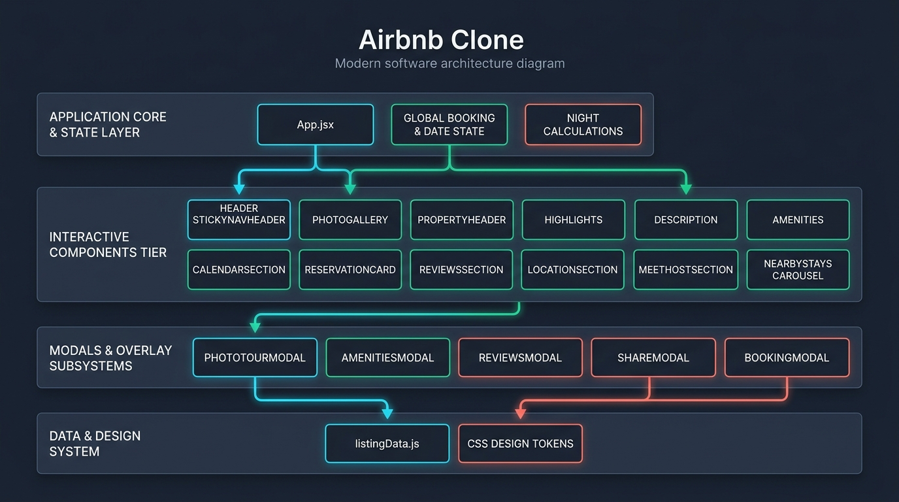

# System Architecture - Airbnb Clone (Playpower Assignment)

This document provides a comprehensive overview of the software architecture and component design for the Airbnb Listing Experience application.

---

## 1. Visual Architecture Overview

---

## 2. Interactive Flowchart (Mermaid)

```mermaid
flowchart TD
    subgraph Core ["1. Application Core & State Layer"]
        App["App.jsx (Root Controller)"]
        State["State Management<br/>(checkIn, checkOut, totalNights, isSaved, isClaimed)"]
        PricingEngine["Pricing & Nights Calculator<br/>(basePrice * nights * discount)"]
        App <--> State
        State --> PricingEngine
    end

    subgraph Views ["2. Interactive Components Tier"]
        Header["Header.jsx & StickyNavHeader.jsx<br/>(Search widget, ScrollSpy tab navigation)"]
        Gallery["PhotoGallery.jsx<br/>(5-photo desktop grid, mobile slider)"]
        Details["PropertyHeader.jsx, HostBadge.jsx,<br/>Description.jsx, Highlights.jsx"]
        AmenitiesSec["Amenities.jsx<br/>(Category preview & modal trigger)"]
        Calendar["CalendarSection.jsx<br/>(Dual-month, custom range connector styling)"]
        Reservation["ReservationCard.jsx<br/>(Sticky widget, guest popover, promo vouchers)"]
        Reviews["ReviewsSection.jsx<br/>(Rating bars, review tags carousel)"]
        Location["LocationSection.jsx<br/>(Interactive zoom map, neighbourhood details)"]
        Host["MeetHostSection.jsx<br/>(Host bio card, co-hosts grid)"]
        Nearby["NearbyStays.jsx<br/>(Interactive multi-page carousel with scroll-snap)"]
    end

    subgraph Modals ["3. Modals & Overlay Subsystem"]
        PhotoModal["PhotoTourModal.jsx<br/>(Full-screen categorized room tour)"]
        AmenModal["AmenitiesModal.jsx<br/>(Full amenities directory)"]
        RevModal["ReviewsModal.jsx<br/>(Searchable review modal)"]
        ShareModal["ShareModal.jsx<br/>(Social sharing options)"]
        BookModal["BookingModal.jsx<br/>(Booking confirmation breakdown)"]
    end

    subgraph Data ["4. Data & Design System"]
        Store[("listingData.js<br/>(Property specs, images, reviews, rules)")]
        Tokens["index.css<br/>(Design Tokens, Responsive Grid, Animations)"]
    end

    %% Connections
    App --> Header
    App --> Gallery
    App --> Details
    App --> AmenitiesSec
    App --> Calendar
    App --> Reservation
    App --> Reviews
    App --> Location
    App --> Host
    App --> Nearby

    App --> PhotoModal
    App --> AmenModal
    App --> RevModal
    App --> ShareModal
    App --> BookModal

    Store --> App
    Tokens -.-> Views
    Tokens -.-> Modals
```

---

## 3. Tier Breakdown

### Tier 1: Application Core & State (`App.jsx`)
- **Central State Controller**: Manages booking dates (`checkIn`, `checkOut`), dynamic night count calculations, promotional discount state (`isClaimed`), saved wishlist toggle (`isSaved`), and modal visibility controllers.
- **Dynamic Pricing Engine**: Automatically computes raw and discounted reservation totals based on selected dates and active promo vouchers.

### Tier 2: Interactive Components
- **Navigation Subsystems**:
  - `Header.jsx`: Fixed top header with Airbnb search pill and user menu popover.
  - `StickyNavHeader.jsx`: Scroll-spy navigation bar with active section indicator tracking scroll position and smooth section anchors.
- **Media & Showcase**:
  - `PhotoGallery.jsx`: 5-photo responsive mosaic with Airbnb 3×3 filled-dot "Show all photos" button.
- **Listing Information**:
  - `PropertyHeader.jsx`, `HostBadge.jsx`: Laurel wreath Guest Favourite badge, verified badge, and host snippet.
  - `Description.jsx`, `Highlights.jsx`: Expandable listing narrative and property highlight badges.
  - `Amenities.jsx`: Curated amenity preview grid with modal trigger.
- **Booking & Dynamic Calculation**:
  - `CalendarSection.jsx`: Dual-month interactive calendar (October & November 2026) with custom `#F2F2F2` continuous pill range highlight connector and disabled dates.
  - `ReservationCard.jsx`: Sticky desktop pricing widget with guest counter popover, date pickers, and promo vouchers.
- **Community & Social Proof**:
  - `ReviewsSection.jsx`: Overall rating hero, category rating progress bars, scrollable review tags, and individual review cards.
- **Host & Surroundings**:
  - `LocationSection.jsx`: Interactive map with zoom controls and neighbourhood notes.
  - `MeetHostSection.jsx`: Host profile badge, co-hosts roster, and messaging button.
  - `NearbyStays.jsx`: Interactive horizontal carousel with scroll-snap and page indicator.

### Tier 3: Modals & Overlay Subsystems
- `PhotoTourModal.jsx`: Full-screen categorized room-by-room walkthrough.
- `AmenitiesModal.jsx`: Complete categorized amenities directory.
- `ReviewsModal.jsx`: Searchable guest reviews directory with search filtering.
- `ShareModal.jsx`: Social media and direct link sharing options.
- `BookingModal.jsx`: Reservation summary breakdown with price details.

### Tier 4: Data & Design System
- `listingData.js`: Centralized mock data store containing property details, high-resolution imagery, co-hosts, reviews, and rules.
- `index.css`: Comprehensive design token architecture (colors, typography, grid layouts, micro-animations, responsive media queries).
